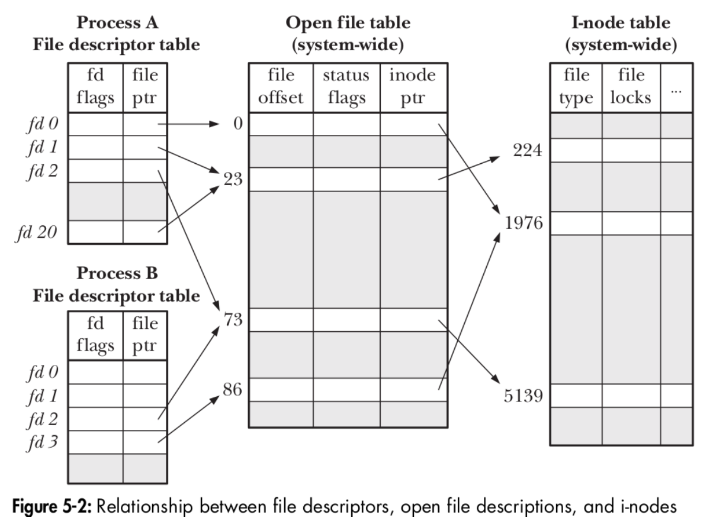
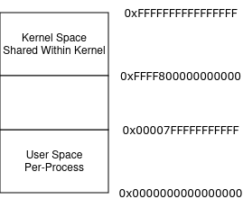
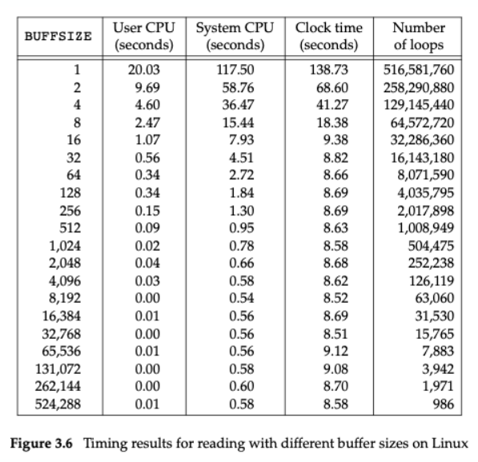
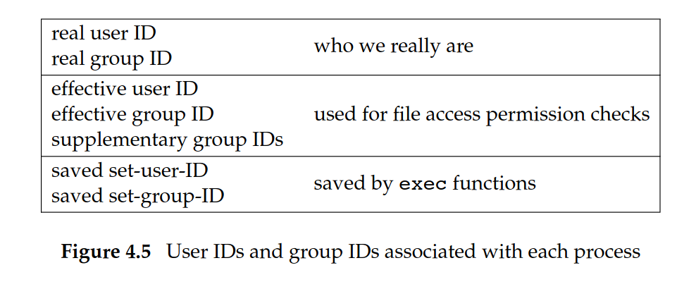
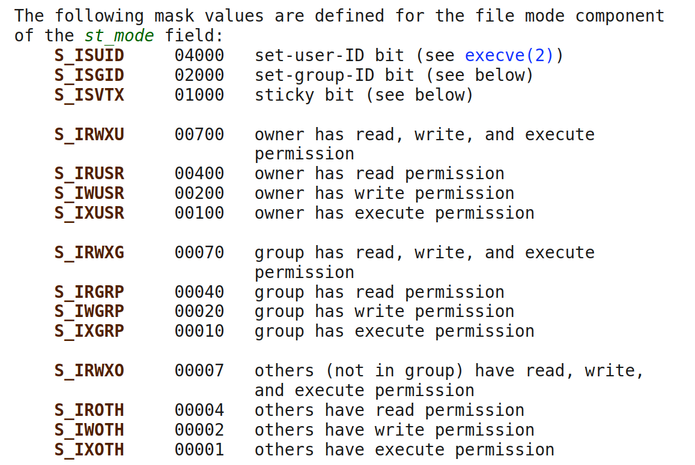
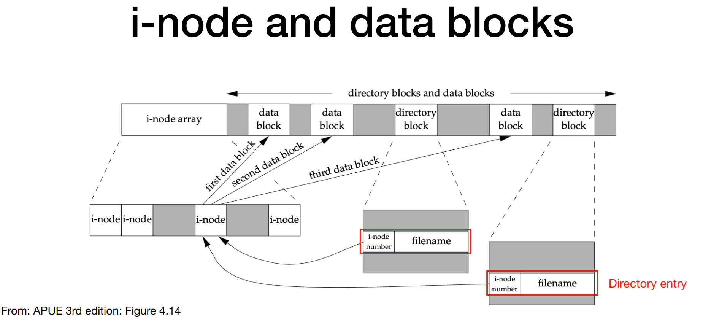
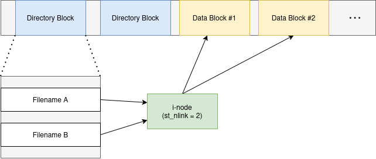
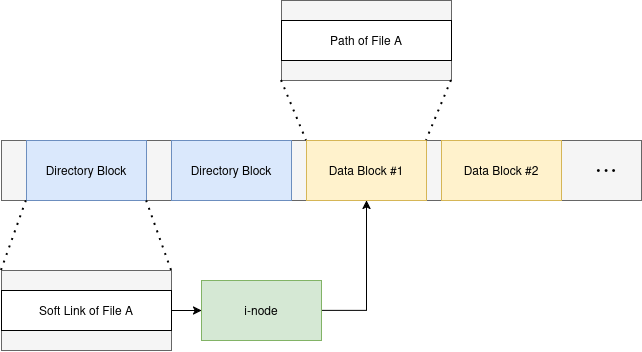
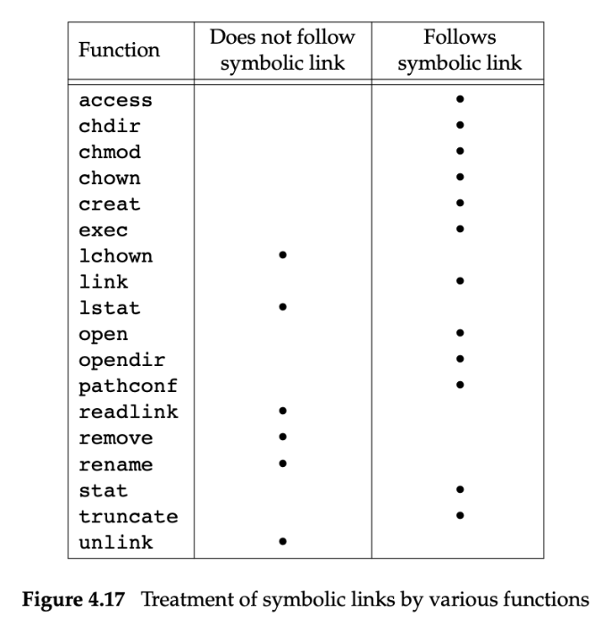

## 什麼是檔案？

在 Unix 系統中，有「everything is a file」的概念，如硬體設備、進程資訊、網路連線、處理器狀態等都抽象化為檔案系統中的一個路徑。透過這種設計，使用者只需要使用一套統一的 API（例如 `open()`, `read()`, `write()`, `close()`），就能操作各種截然不同的系統資源，而不需要為每一種硬體另外撰寫專屬的操作介面。比方說 `/proc/cpuinfo` 這個路徑包含了 CPU 資訊， `/dev/sda` 則代表整顆實體硬碟。

對於使用者來說，一個檔案通常用一個路徑表示；在大部分 C 程式內，則用一個 `FILE*` 指標表示。而在作業系統中，則是用 File Descriptor 、 File Description 、 Vnode 三個分層架構來代表一個檔案。

File Descriptor (檔案描述符，簡稱 FD)，存在於進程內部（User Space 下），只是一個整數索引值。當一個程式用 `fopen` 開啟一個檔案並回傳 `FILE*` 指標時， 一個新的 FD 會被加入到每個進程獨立的 File Descriptor Table 中。實際上， `FILE*` 指標也只是對 FD 的包裝。
FD 的用途，是當程式要求對檔案進行操作時，讓 Kernel 知道順著該索引值，從 File Descriptor Table 知道要去存取哪個 File Description。對進程來說，它不需要知道硬碟在哪裡、檔案系統是什麼。它只要拿到這個整數代號，就能透過 Syscall 告訴核心要對代號 `3` 寫入資料。

File Description (檔案描述項)，儲存了本次開啟的操作狀態，包含讀寫的 Offset、開啟模式（如唯讀）、Reference Count（有多少個 FD 指向這個 File Description）。當 Kernel 對檔案進行操作時，需要知道寫入的位置在哪（例如寫入第 `6767` byte），如果每次存取都需要重新指定位置、或者明明不該寫入卻有實習生 vibe 出來， File Description 解決諸如此類問題。
而且 File Description 可以是每個進程各有一個，或者多個進程共用一個，因此進程們可以選擇「各自擁有獨立的狀態」，也可以選擇「多個進程一起共用同一個狀態」。可以想像，多個進程如果他們的*不同* FD 都指向同一個 File Desctiption，那麼 A 讀取到第 1000 bytes， B 也會從 1000 bytes 開始讀取。

Vnode，檔案的實體指標，儲存檔案的擁有者、權限、檔案大小、修改時間，以及資料實際儲存在硬碟哪些磁區的對應指標，由 File Description 指著，實際存在硬碟上。他會在檔案開啟時由 Kernel 從硬碟上複製到記憶體中，可以加快檔案存取速度。

Kernel 會分別維護三種結構來儲存上面三個東西：File Descriptor Table、Open File Table、Vnode Table（或 Inode Table）。

FD Table 每個進程都會有一個，他實際上只是一個陣列，所以可以用整數 FD 存取。預設情況下，該 Table 會預先開啟三個 FD，分別是 `stdin`、`stdout`、`stderr`，由 0、1、2 表示。再往後開啟的檔案，都由 3 往上加。其他兩者都是整個系統共用的，不會有其他副本。

> [!NOTE] 複製/繼承FD
> `dup(2)` 是複製一個已有的 FD 到目前最小可用的 FD 數字去。當使用 `dup(2)`，原本的 FD 與新的 FD 便都指向 Open File Table 中的同一個 File Description，兩者的檔案操作也會互相同步。
> `fork(2)` 作用是創造一個目前進程的子進程。子進程會繼承父進程的 FD ，所以兩者會有指向同一個 File Description，但是不同的 FD。下圖的 Process A 與 Process B 就有可能是父子進程。

下圖展示了上面三個數據結構的關係：

來源：[lusp_fileio_slides.pdf](https://man7.org/training/download/lusp_fileio_slides-mkerrisk-man7.org.pdf)
###  Source Code Trace

`task_struct` 是 Process Control Block ，每個進程都有一個，包含該進程的各種資訊，當中的 `files` 是一個指向 File Descriptor Table 的指標：
[/include/linux/sched.h](https://github.com/torvalds/linux/blob/master/include/linux/sched.h#L835)
```c
struct task_struct {
    ...
    struct files_struct *files;
    ...
};
```

這就是每個 Process 的 File Descriptor Table，可以看到 `fd_array` 是一個陣列：
[/include/linux/fdtable.h](https://github.com/torvalds/linux/blob/master/include/linux/fdtable.h#L26)
```c
struct files_struct {
    ...
    struct fdtable __rcu *fdt;
    struct fdtable fdtab;
    struct file __rcu *fd_array[NR_OPEN_DEFAULT];
    ...
};
```

[/include/linux/fdtable.h](https://github.com/torvalds/linux/blob/master/include/linux/fdtable.h#L26)
```c
struct fdtable {
    ...
    struct file __rcu **fd;
    ...
};
```

初始狀態下， `files_struct.fdt` 指向 `files_struct.fdtab` ，而 `files_struct.fdtab.fd` 又指向 `files_struct.fd_array` 。這樣實作的好處是，大部分進程開啟的檔案數量都很少（<64），所以先以靜態分配出 `NR_OPEN_DEFAULT` 大小，讓 `fdtab.fd` 指向 `fd_array` ，後續擴展再更換 `files_struct.fdt` 所指向的位置，存取時只需要統一讀取 `files_struct.fdt.fd` ，此外還能供多執行緒在無鎖狀態下讀取。

下面的 `struct file` 是存在 Open File Table 中的結構：
[/include/linux/fs.h](https://github.com/torvalds/linux/blob/master/include/linux/fs.h#L1255)
```c
struct file {
    ...
    fmode_t	f_mode; // 檔案模式：唯讀、唯寫...
	struct inode *f_inode; // 指向該檔案的 metadata
	loff_t f_pos; // 當前讀寫位置
	file_ref_t f_ref; // 追蹤 FD 引用
    ...
}
```

而 `struct file` 結構內則有 `f_inode` 指向該檔案的 metadata。實際上， linux 中沒有所謂的  Open File Table 這個"結構"，他是靠 Mempool 來分配 `struct file` 實際上的空間，以及利用 `f_ref` 追蹤有多少指標指向這塊記憶體，再加上 `fdtable` 來達成 $O(1)$ 存取 `struct file`。

> [!NOTE] 結構儲存位置
> 進程的虛擬記憶體，被分為兩大塊：Kernel Space 下共用的記憶體、User Space 下的記憶體。而 User Space 下只會知道 `files_struct.fdt.fd` 中的陣列索引值，即先前提到的 FD；在 Kernel Space 下則存著 `task_struct` 、 `files_struct` 、 `fdtable` 、 `file` 等結構，防止有人惡意篡改導致內核大爆炸。也就是說，這些結構是每個進程都會有一個，但是存在 Kernel Space 中，且由 Kernel 維護。
> 

### Vnode vs. Inode

Vnode （Virtual Node）由 Sun Microsystems 為 Solaris / BSD 系統開發，主要由 Unix 系統使用。早期的 Unix 只支援 Unix 自家的檔案系統（UFS），可以直接使用實體磁碟上的 Inode。但後來為了支援網路檔案系統（NFS）以及其他非 Unix 檔案系統，引入了 VFS （Virtual File System） 與 Vnode 抽象介面。Vnode 代表記憶體中的通用檔案物件，封裝不同檔案系統的 IO 操作，並指向底層具體檔案系統的實體 Inode。 Inode 是實際存在磁碟上的，由 OS 從磁碟讀取到記憶體中。

Linux 採用的 Inode （Index Node）繼承並改進了 VFS 的思想，直接將 Vnode 的抽象操作介面整合進記憶體中的 Inode 。其包含儲存檔案的 Metadata，例如：檔案大小、權限、修改時間、存取控制等等。此外，Linux 將路徑結構從 Inode 拆分出來，引入了 Dentry（Directory Entry），而 Dentry 結構再指向 Inode。

在傳統 Vnode 架構中，路徑解析會逐層查找目錄，並透過檔案系統提供的 Lookup 操作找到對應的檔案物件。在 Linux 中，VFS 利用 Dentry Cache 及其 Hash Table 加速路徑查找；若找到快取的 Dentry，就能透過它取得對應的 Inode，否則可能需要呼叫底層檔案系統進行查找。對於 Hard Link，不同的目錄項目可以對應到同一個 inode，因此同一個檔案可以有多個名稱。

## 什麼是 I/O？

I/O（Input/Outputs）指任何與檔案的操作，在 Unix 中， I/O 被分為緩衝式 IO（Buffered/Standard I/Os）與非緩衝式 IO （Unbuffered I/Os）。

- Buffered I/Os：存取會儲存輸入在中介的緩衝區中，當某些條件滿足才會呼叫 syscall 
- Unbuffered I/O： 每次存取都會呼叫 syscall ，但 Kernel 中還是可以有緩衝區

舉例來說，常見的 Buffered IO 有 `fread/fwrite` ， C Standard Library 中有對這兩者作一個存在 User Space 下的緩衝區，當緩衝區滿了、程式呼叫 `fflush` 、呼叫 `fclose` 關閉檔案、正常結束時，才會將緩衝區內容用 Syscall 實際寫入檔案。

而 `read/write` 等 Syscall 的緩存是存在 Kernel 的 Page Cache 中， `write` 將資料複製到 Kernel 的 Page Cache 後便立即返回，此時資料頁被標記為 Dirty Page，由背景執行緒（如 `flusher`/`pdflush`）非同步寫回磁碟。`read` 會優先從 Page Cache 搜尋，若有則直接複製到 User Space；沒有才從磁碟讀取並載入 Cache。

> [!NOTE] Page 分頁
> 分頁（Page）是現代作業系統與 CPU 用來管理記憶體的基本單位，通常大小為 4KB。可以把分頁想成一塊固定大小的虛擬記憶體，之所以說是虛擬記憶體，是因為分頁是由名為 MMU（Memory Management Unit） 的硬體透過頁表（Page Table）轉換到實體記憶體的地址。這樣做可以使得虛擬記憶體中連續的分頁，在實體記憶體中不需要連續，解決了記憶體碎片化的問題，且分配記憶體更有效率。
> 
> 記憶體碎片化是指系統記憶體被分割成許多不連續的小塊，導致總空閒空間足夠，卻無法滿足大型記憶體配置需求的現象。

測測看以不同緩衝區大小讀取 ~516MB 的檔案，所需的時間：

來源：APUE 3rd Edition Figure 3.6

注意到在 `BUFFSIZE` >= 32 之後，所需的實際時間（Clock time）都落在 8~9 秒，這就是先前提到的 Page Cache 在發力，這兩種優化大型讀寫操作的機制稱為 Read Ahead 與 Delayed Write。

- Read Ahead：當 Kernel 注意到有人在依序讀取一個檔案的內容時，會事先讀取更多內容到 Page Cache 中，未來的讀取操作只在記憶體中完成。可以用 `posix_fadvise(2)` ，主動通知 Kernel 提前將資料從磁碟載入 Page Cache。
- Delayed Write：當一個程式多次寫入同一個檔案區塊時， Kernel 不會每次都實際存取硬碟，而是先覆蓋掉先前的 Page Cache 之後再一次寫入到磁碟中。可以用 `fsync(2)` ，強制將 Dirty Page 立即刷回實體磁碟。

> [!NOTE] 測時間
> 可以使用 shell 指令 `time` 來測試執行一個程式所需的時間
> ```
> $ time ls
> ...
> real 0m0.013s
> user 0m0.004s
> sys  0m0.009s
> ```
> `real` 是實際花費的總時間，`user` 是程式在 User Space 下花的時間， `sys` 是程式在 Kernel Space 下花的時間。
## 操作檔案的 Syscall

```c
int open(const char *pathname, int flags, ... /* mode_t mode */ );
```

開啟或建立指定的檔案路徑，回傳新的 File Descriptor。
* `flags`：控制開啟行為（如 `O_RDONLY`唯讀、`O_WRONLY`唯寫、`O_CREAT`建立、`O_APPEND`附加、`O_CLOEXEC`執行時關閉）。
* `mode`：當包含 `O_CREAT` 時必須傳入，指定新建檔案的存取權限（如 `0644`）。

```c
int openat(int dirfd, const char *pathname, int flags, ... /* mode_t mode */ );
```

以指定目錄 `dirfd` 為基準點開啟相對路徑檔案，用於防止 TOCTOU（競態條件）攻擊與多執行緒下的路徑解析競爭。
* `dirfd == AT_FDCWD`：行為完全等同於傳統 `open()`（以當前工作目錄為基準）。
* 若 `pathname` 為相對路徑：相對於 `dirfd` 所指向的目錄進行路徑解析。
* 若 `pathname` 為絕對路徑：忽略 `dirfd` 參數。

較新版的 Unix 系統提供以 `/dev/fd/x` 開啟 File Descriptor `x` 。比方說，以 `open` 打開 `/dev/fd/0` 等同於 `dup(0)`。

---

```c
int close(int fd);
```

關閉指定的 `fd`，釋放 Kernel 中對應的資源與減少系統檔案結構參考次數，相關的 File Description 直到所有指向他的 `fd` 都關閉了才會釋放。

> [!WARNING] Warning
> 當該檔案的參考計數歸零時，Kernel 才會真正釋放實體資源；成功關閉並不保證 Page Cache 中的資料已被寫到磁碟上（要確保寫入搭配 `fsync(2)`）。

---

```c
ssize_t read(int fd, void buf[.count], size_t count);
```

嘗試從 `fd` 指向的檔案或設備中，讀取最多 `count` 個位元組到 User Space 的緩衝區 `buf` 中，讀取完會移動 File Offset。回傳實際讀取到的位元組數；回傳 `0` 表示讀取到 EOF；回傳 `-1` 表示失敗並設定 `errno`。

---

```c
ssize_t write(int fd, const void buf[.count], size_t count);
```

將 User Space 緩衝區 `buf` 中最多 `count` 個位元組寫入至 `fd` 對應的檔案或設備中，讀取完會移動 File Offset。回傳實際寫入的 bytes 數；回傳 `-1` 表示失敗並設定 `errno`。如果 `count` 是 `0` 且有錯誤發生，回傳 `-1` 並設定 `errno` ，否則無事發生。

---

```c
off_t lseek(int fd, off_t offset, int whence);
```

 設定`fd` 的開啟檔案偏移量。
* `SEEK_SET`：將 Offset 設定為檔案開頭加上 `offset` 位元組。
* `SEEK_CUR`：將 Offset 設定為當前位置加上 `offset` 位元組。
* `SEEK_END`：將 Offset 設定為檔案結尾加上 `offset` 位元組。

而 `lseek` 也可以用來在檔案中創建 File Hole，參考以下程式碼：

```c
char buf1[] = "part1";
char buf2[] = "part2";
int fd = open("file.hole", O_WRONLY | O_CREAT);
write(fd, buf1, sizeof(buf1));
lseek(fd, 16384, SEEK_SET);
write(fd, bu2, sizeof(buf2));
```

然後將 `file.hole` 的內容寫入到另一個檔案 `file.nohole` 中：
```
$ cat file.hole > file.nohole
```

來看看兩者所使用的磁碟大小：
```
$ ls -ls file.hole file.nohole
 8 -r-xrwx--- 1 admin admin 16390 Oct  2 19:43 file.hole
20 -rw-rw-r-- 1 admin admin 16390 Oct  2 19:43 file.nohole
```

第一個數字代表使用的磁碟區塊數量，可以看到 `file.hole` 使用的區塊僅有 8 個。這是因為當寫入的地方遠大於檔案末尾時，作業系統會在 Inode 中注記這裡有個空洞，而不是直接寫入那麼多個 bytes。

> [!NOTE] File With Holes
> 這種有洞的檔案也叫做 Sparse File（稀疏檔案），當程式需要存取大範圍的地址時，卻又不太可能用到所有潛在的磁碟區塊，稀疏檔案就非常有用。這項技術常用於虛擬機中用來儲存虛擬磁碟。假設一台虛擬機配置了 20 GB 的磁碟，但這塊區域不會立刻被資料填滿。與其直接建立實體占用 20 GB 的檔案，不如建立一個 20 GB 的稀疏檔案，它一開始只會佔用幾個磁碟區塊，之後再由虛擬機以較慢的速度並陸續寫入檔案，這樣做比較有效率。
> 
> 稀疏檔案也可以在其部分區塊被清空（例如以 `'\0'` 填滿）時縮減實際佔用的容量。支援稀疏檔案的程式在執行此操作時，可以不必真的將資料寫入這些區塊，而是直接將它們從檔案中移除（即在檔案中「打洞」）。這樣做的效果完全相同，因為程式在讀取未分配的區塊時，系統一律會回傳零。
> 
> 稀疏檔案與「預先分配（Preallocation）」的概念相反，它們實現了所謂的精簡自動配置（Thin provisioning），有時也被稱為磁碟超額承諾（Disk overcommitment）。這讓你能建立出超越實際實體硬體容量的「虛擬磁碟空間」，並只在有必要時才擴充實體磁碟來增長檔案系統。

譯自：[linux - what is file hole and how can it be used?](https://stackoverflow.com/a/13982618)

---

```c
int dup(int oldfd);
```

複製 `oldfd`，並自動使用當前編號最小且未使用的 FD 作為新的檔案描述符。

```c
int dup2(int oldfd, int newfd);
```

將 `oldfd` 複製到指定編號的 `newfd` 上（常用於 Shell 的 Redirection，如重導向 stdout 到檔案）。若 `newfd` 已經被開啟，`dup2` 會先自動且原子性地將 `newfd` 關閉再進行複製；若 `oldfd == newfd` 則直接回傳 `newfd`。

---

```c
int fcntl(int fd, int op, ...);
```

對已開啟的 `fd` 進行低階屬性控制與操作，有許多種 `op` 可選，後面再加上該 `op` 指定的參數，以下列出其中幾種 `op`。
* `F_GETFL` / `F_SETFL`：取得或修改檔案 Status Flags（如切換是否為 `O_NONBLOCK` 非阻塞模式）。
* `F_DUPFD` / `F_DUPFD_CLOEXEC`：複製 FD 並設定指定下限。
* `F_SETLK` / `F_SETLKW`：對檔案區域進行加鎖。

---

```c
int ioctl(int fd, int op, ...);
```

設備驅動程式的萬用控制介面，用於處理無法映射到一般 `read`/`write` 的硬體設備與特殊檔案操作。通常來說， `op` 會根據寫入的驅動程式有所不同，且驅動可以自定義 `op`。
例如：查詢/設定網路卡介面參數（如 MAC/IP）、控制 Serial Port 傳送速率、取得終端機視窗大小（`TIOCGWINSZ`）、控制驅動特有硬體行為。
## 同時讀寫

考慮有兩個進程 A、B 同時執行這份程式碼，將 `buf` 寫入檔案末尾：
```c
if (lseek(fd, 0, SEEK_END) < 0)
    err_sys("lseek error");
if (write(fd, buf, 100) < 0)
    err_sys("write error");
```

假設 A 寫入：
```
There are no race conditions here.\n
```

假設 B 寫入：
```
There are 67
```

如果 A 先執行 `lseek + write` ，B 再執行 `lseek + write` ，或者反過來。那麼一切安好，兩者寫入的內容會先後出現在檔案中：
```
There are no race conditions here.
There are 67
```

但我們知道 CPU 會作排程，因此有可能 B 先執行 `lseek` ，換 A 執行 `lseek + write` 再換 B 執行 `write`：
```
There are 67 race conditions here.

```

而 A 寫入的東西就被 B 覆蓋掉，這種情況叫做 Race Condition。
> [!NOTE] Race Condition
> A race condition occurs when multiple processes are trying to do something with shared data and the final outcome depends on the order in which the processes run. (From Chap. 8.9 of the APUE text book)

如果有多個使用者同時執行一個寫入紀錄檔到同一個檔案的程式，這些紀錄就有可能互相覆蓋。為了解決這個問題， Unix 引入了兩種操作： Atomic Operation 與 File/Record Locking 。
### Atomic Operations

```c
ssize_t pread(int fd, void buf[.count], size_t count, off_t offset);
ssize_t pwrite(int fd, const void buf[.count], size_t count, off_t offset);
```

從指定的 `offset` 位置讀取/寫入，不會改變檔案原本的 File Offset。

* 好處：將 `lseek()` 與 `read()` 合併為一個操作。
* 常用場景：多執行緒或父子進程共用同一個 `fd` 進行並行讀取時，避免因為 `lseek` 與 `read` 之間的 Race Condition 導致資料讀取錯亂。

### File/Record Locking

Advisory Lock （僅供參考的鎖）是一種依賴進程之間合作的檔案鎖，所有要存取該資料的進程都要先檢查該檔案是否有鎖、等待鎖釋放再進行存取。之所以說僅供參考，是因為若當一個外來進程不檢查檔案是否有所就直接存取，系統是無法擋下該次操作的。

Mandatory Lock 會讓 Kernel 去檢查該次存取有沒有違反鎖的條件，若違反則強制擋下該操作。現在 Linux 已經捨棄 Mandatory Lock ，因為 Kernel 必須在每次 `read()` 與 `write()` 呼叫時都檢查檔案鎖狀態，極度消耗系統資源。

- File Locking：確保只有特定程式能夠存取整個檔案的機制
- Record locking (or byte range locking)： 確保只有特定程式能夠存取*部份檔案區塊*的機制

鎖還有共用（Shared）與排他（Exclusive）的區別，這種區別的核心思想是：寫入時其他人不能讀取或寫入；讀取時其他人也能讀取，但不能寫入。如果可以同時寫入，就會出現上面的 `There are 67 race conditions` ；同時讀取與寫入，就不保證讀取那方接收到的是正確的資料，唯一能接受的就是同時讀取，因為資料不會變。
共用鎖，就是保證大家可以同時讀取到對的資料；排他鎖，就是保證同時只有一個人能寫入與讀取。因此共用鎖可以多人擁有，而排他鎖與共用鎖不能共存。

以下介紹給檔案上鎖的 Functions：

```c
int flock(int fd, int op);
```
對 `fd` 所指的檔案整個加上鎖，成功回傳 `0` ，不成功回傳 `-1` 並設定 `errno`。`op` 可以是以下多個值：
- `LOCK_SH`：請求共用鎖
- `LOCK_EX`：請求排他鎖
- `LOCK_UN`：移除自己擁有的鎖
- `LOCK_NB`：當有其他進程持有排他鎖時，不等待該進程釋放鎖就返回，須搭配其他參數使用

---

```c
int lockf(int fd, int op, off_t size);
```
由 Standard C Library 提供，包裝 `fcntl` 的區域加鎖功能，對當前檔案 `offset` 後 `size` bytes 加鎖。`op` 可以是以下多個值：
- `F_LOCK`：請求排他鎖，若已被其他進程鎖定，會持續等待直到鎖釋放
- `F_TLOCK`：測試並加鎖，若已被鎖定則不等待，立即回傳失敗（`errno` 設為 `EACCES` 或 `EAGAIN`）
- `F_ULOCK`：解鎖指定範圍，也可以用於將已鎖定的區域解鎖一部份
- `F_TEST`：測試鎖狀態，僅檢查指定區域是否被其他人鎖定，不會真的加鎖，若已被鎖定回傳 `-1`，未被鎖定回傳 `0`

使用 `fcntl(2)` 實現 `lockf` 操作：
```c
struct flock {
    short l_type; /* F_RDLCK, F_WRLCK, F_UNLCK */
    short l_whence; /* SEEK_SET, SEEK_CUR, or SEEK_END, same as the whence in lseek*/
    off_t l_start; /* offset in bytes relative to whence */
    off_t l_len; /* length, in bytes, 0 means lock to EOF */
    pid_t l_pid; /* filled in by F_GETLK, ignore otherwise */
}
```
```c
#include <fcntl.h>
struct flock lock;
lock.l_type = F_RDLCK; /* F_RDLCK, F_WRLCK, F_UNLCK */
lock.l_start = 0; /* byte offset, relative to l_whence */
lock.l_whence = SEEK_SET; /* SEEK_SET, SEEK_CUR, SEEK_END */
lock.l_len = 6767; /* #bytes (0 means to EOF) */
int ret = fcntl(fd, F_SETLK, &lock);  /* F_SETLK: set the lock */
```
- `F_RDLCK` ： 請求 Read Lock ，也就是共用鎖。
- `F_WRLCK` ： 請求 Write Lock 排他鎖，也就是排他鎖。

`fcntl` 還支持 `F_GETLK` 參數，用來測試目前給定的鎖能否被放置，如果可以，便把 `lock.l_type` 改成 `F_UNLCK` ；不行的話就把 `lock` 的各參數改為目前放在檔案上的鎖的細節。此外，`F_SETLKW` 參數會等待其他進程釋放鎖再設置請求的鎖。

> [!WARNING] `fctnl` 與 `lockf` 等 POSIX 檔案鎖的注意事項
> 如果有進程關閉它擁有的任何一個指向該檔案的 File Descriptor ，那麼系統會釋放該進程在這個檔案上擁有的所有鎖，不論這個鎖是否與關閉的 File Descriptor 有關聯。
> 考慮這段程式碼：
> ```c
> fd1 = open(filename, ...);
> lockf(fd1, ...);
> fd2 = open(filename, ...);
> close(fd2);
> ```
> 在 `close(fd2)` 時，從 `fd1` 獲得的鎖便會被移除。*但是*由 `flock` 所加的鎖不會被移除，因為 `flock` 的鎖的擁有者是綁定在 File Description 上，而 `fcntl` 所加的鎖綁在 File Descriptor Table 上。簡單來說，`fcntl/lockf`的鎖只要有一個 `fd` 被關掉了，這個檔案上的全部鎖都會釋放。而 `flock` 的鎖會等到所有 `fd` 被關掉了，鎖才會不預期消失。

#### Source Code Trace
在 Linux 中，  File Locks 被存在 inode 中：
[/inclue/linux/fs.h](https://github.com/torvalds/linux/blob/master/include/linux/fs.h#L850)
```c
struct inode {
    ...
    struct file_lock_context	*i_flctx;
    ...
};
```

```c
struct file_lock_context {
    spinlock_t          flc_lock;   /* Protects the fields/lists below */
    struct list_head    flc_flock;  /* Head of the list for flock(2) locks */
    struct list_head    flc_posix;  /* Head of the list for fcntl(2) / POSIX locks */
    struct list_head    flc_lease;  /* Head of the list for file leases */
};
```

#### 程式實作

這個程式讀取使用者輸入並寫入到檔案末尾，同時會給檔案加上 Exclusive Lock 防止其他程式同時寫入。

```c
char buf[100];

int main() {
    int fd;
    if ((fd = open("log", O_WRONLY | O_CREAT, 0644)) < 0)
        err_sys("open error");

    printf("waiting for exclusive lock... ");
    fflush(stdout);
    if (flock(fd, LOCK_EX) < 0)  // wait for exclusive lock
        err_sys("flock error");
    printf("lock acquired.\n");

    printf("content to write: ");
    scanf("%s", buf);

    if (lseek(fd, 0, SEEK_END) < 0)
        err_sys("lseek error");
    if (write(fd, buf, sizeof(buf)) < 0)
        err_sys("write error");

    if (flock(fd, LOCK_UN) < 0) // release lock
        err_sys("flock error");
    printf("lock released.\n");

    if (close(fd) < 0)
        err_sys("close error");
}
```

如果同時執行兩個程式：
```
$ ./write_log
waiting for exclusive lock... lock acquired.
content to write: 
```

```
$ ./write_log
waiting for exclusive lock...
```

第二個 Process 會卡在等待 Exclusive Lock 的過程直到第一個 Process 完成寫入。

```
$ ./write_log
waiting for exclusive lock... lock acquired.
content to write: There are no race conditions here.
lock released.
```

```
$ ./write_log
waiting for exclusive lock...
content to write: 
```

### Nonblocking I/O

如果有嘗試使用 `read` 讀取 `stdin` ，會發現如果使用者沒在 Terminal 輸入東西，那麼程式就會一直卡在 `read` 中，沒辦法處理其他事情：

```c
char buf[100];
int n = read(STDIN_FILENO, buf, sizeof(buf)); // <-- 卡在這
...
```

Nonblocking IO 讓我們發起一個操作請求，然後直接回傳**請求能否執行的結果**，該請求後續會由 Kernel 完成。舉例來說，Nonblocking read 可以盡量讀取資料而不會卡住整個進程，但同時讀取結果也可能是什麼都沒有，此時 `errno` 會說明操作無法完成（`EAGAIN`）。


而 Blocking IO 會等 Kernel 所有操作都做完了才會回傳結果，讓呼叫該 Syscall 的程式卡著。


來源：[Go 语言网络轮询器的实现原理](https://draven.co/golang/docs/part3-runtime/ch06-concurrency/golang-netpoller/)

> [!Note] Slow/Fast System Call
> Slow System Call 指會需要不確定時間來完成的 Syscall ，比方說 `read` 從終端機讀取使用者輸入就要等待使用者按下 Enter。而 Fast System Call 指一定會在確定的時間內完成的 Syscall ，例如 `lseek` 。

要讓某個 FD 開啟 Nonblocking 模式，可以在 `open` 時加上 `O_NONBLOCK` 標誌，或者後面使用 `fcntl` 加上 `O_NONBLOCK`：

```c
open(filename, O_WRONLY | O_NONBLOCK, ...);
// or
fcntl(fd, F_SETFL, O_NONBLOCK);
```

程式實作：
```c
char buf[500000];

void set_fl(int fd, int flags) {
    int val;
    val = fcntl(fd, F_GETFL, 0);
    val |= flags;
    fcntl(fd, F_SETFL, val);
}

int main() {
    int bytes_read = read(STDIN_FILENO, buf, sizeof(buf));
    fprintf(stderr, "read %d bytes from stdin\n", bytes_read);

    char* ptr = buf;
    set_fl(STDOUT_FILENO, O_NONBLOCK);

    int bytes_left = bytes_read;
    int eagain = 0;
    while (bytes_left > 0) { // 一直等待寫入的過程就叫 polling
        errno = 0;
        int bytes_written = write(STDOUT_FILENO, ptr, bytes_left);
        if (errno == EAGAIN) {
            eagain++;
        } else {
            if (eagain > 0) {
                fprintf(stderr, "EAGAIN * %d...\n", eagain);
                eagain = 0;
            }
            fprintf(stderr, "write %d bytes, errno = %d\n", bytes_written, errno);
        }
        if (bytes_written > 0) {
            ptr += bytes_written;
            bytes_left -= bytes_written;
        }
    }
    exit(0);
}
```

執行：
```
$ ./a.out < /var/log/syslog 2>stderr.out
```

`stderr` 輸出：
```
read 500000 bytes from stdin
write 20204 bytes, errno = 0
EAGAIN * 13...
write 6027 bytes, errno = 0
EAGAIN * 1...
write 93152 bytes, errno = 0
EAGAIN * 23...
write 3868 bytes, errno = 0
EAGAIN * 19759...
write 4357 bytes, errno = 0
EAGAIN * 22...
write 4025 bytes, errno = 0
EAGAIN * 8...
write 4417 bytes, errno = 0
write 97453 bytes, errno = 0
EAGAIN * 14178...
write 3500 bytes, errno = 0
write 87348 bytes, errno = 0
EAGAIN * 14785...
write 3436 bytes, errno = 0
write 104257 bytes, errno = 0
EAGAIN * 12351...
write 4750 bytes, errno = 0
EAGAIN * 7...
write 5021 bytes, errno = 0
EAGAIN * 14...
write 3193 bytes, errno = 0
EAGAIN * 258...
write 54992 bytes, errno = 0
```
### I/O Multiplexing

Nonblocking IO 似乎很好，當 Kernel 回傳 `EAGAIN` 時，程式可以先去處理其他事情，再回來嘗試讀取檔案。不過，用 `while` 迴圈頻繁檢查寫入，會佔用大量 CPU 資源。有沒有一種方法， 讓程式只在有資料可讀取、可寫入時佔用資源，其他時間就像不存在一樣？有的，兄弟，有的，考慮以下情境：

你正在開發一個線上聊天程式，當使用者發送訊息的時候，會將內容廣播給所有人，而其他人發送的訊息也要同步給使用者看到。因此，這個程式會需要從 `stdin` 讀取使用者的輸入內容，同時從網路 socket 讀取伺服器傳給使用者的其他聊天訊息。

你自然而然的寫：
```c
read(STDIN_FILENO, buf, sizeof(buf));
...
read(socket_fd, netbuf, sizeof(netbuf));
```

但 Blocking IO 沒辦法同時讀取兩個輸入，也就是必須等到使用者輸入完內容，才會將網路內容讀入 `netbuf`。所以你順勢改為使用 Nonblocking IO：
```c
set_fl(STDIN_FILENO, O_NONBLOCK);
set_fl(socket_fd, O_NONBLOCK);
...
while (1) {
	read(STDIN_FILENO, buf, sizeof(buf));
	...
	read(socket_fd, netbuf, sizeof(netbuf));
}
```

確實可以同時讀取了，但你看著高漲的 CPU 使用量，陷入了沉思。在一番思索後，你選擇將讀取 `stdin` 與 socket 的程式分為兩個線程，不過，你並沒有處理多線程溝通的經驗，各種 Race Condition 在你眼前炸開，這個方案似乎不夠優雅。

針對這個情境，在單一進程中*高雅*解決這個問題的正解是使用 **IO Multiplexing（IO 多路復用）**。其核心思想是讓 Kernel 幫你監視多個 File Descriptor，所以他的好處有系統開銷小、不必維護多線程/進程。以上述例子，當 `STDIN_FILENO` 或 `socket_fd` 有資料可讀時，Kernel 才會喚醒你的程式，否則程式會進入睡眠（Suspended）。

IO Multiplexing 常見的使用場景包含：
- 需要同時處理多個 File Descriptor
- 等待任一個 File Descriptor 可以讀寫會導致阻塞

而使用 IO Multiplexing 的 Syscall 有 `select`、`poll`：
```c
int select(int nfds,
           fd_set *readfds, fd_set *writefds, fd_set *exceptfds,
           struct timeval *timeout);
```
監聽多個 FD 的事件狀態（可讀、可寫、異常），當有 FD 準備就緒或逾時，傳入的集合中就緒的 FD 會被設為 1 並返回， FD 的最大可設置值為 `FD_SETSIZE-1` 。成功即回傳就緒 FD 的總數，逾時回傳 0，失敗回傳 -1 並設定 `errno`。
- `nfds`：要檢查的 FD 數量上限，必須設為所有集合中**最大的 FD 值 + 1**
- `readfds`：請求監聽**可讀**事件的 FD 集合；當核心發現有資料可讀時會保留相應 FD
- `writefds`：請求監聽**可寫**事件的 FD 集合；當核心發現可寫入（緩衝區有空間）時會保留相應 FD
- `exceptfds`：請求監聽**異常**事件的 FD 集合
- `timeout`：等待的最大時間長度；若傳入 `NULL` 則無限期阻塞，直到有事件發生為止

此外，`fd_set` 可以用以下四個宏操作：
```c
fd_set set;
FD_ZERO(&set);            // 清空集合
FD_SET(fd, &set);         // 將 fd 加入集合之中
if (FD_ISSET(fd, &set));  // 檢查集合中是否有 fd
FD_CLR(fd, &set);         // 將 fd 從集合中移除
```

簡單實作：
```c
int main() {
	fd_set read_set, ret_set;
	FD_ZERO(&read_set);
	FD_ZERO(&ret_set);
	
	FD_SET(0, &read_set);
	int nfds = 0 + 1; // 最大 fd + 1
	
	while (true) {
		memcpy(&ret_set, &read_set, sizeof(fd_set)); // 讓 read_set 不要被覆蓋
		select(nfds, &ret_set, NULL, NULL, NULL); // 無限等待
		for (int i = 0; i < nfds; i++) {
			if (!FD_ISSET(i, &read_set) || !FD_ISSET(i, &ret_set)) continue;
			char buf[100];
			read(fd, buf, sizeof(buf)); // 對 fd 做點啥
		}
	}
}
```
---

```c
int poll(struct pollfd *fds, nfds_t nfds, int timeout);
```

監聽結構陣列中指定的多個 FD 事件狀態，改善 `select` 能夠指定的 FD 數量上限的問題。當有事件觸發或逾時會返回，成功回傳就緒 FD 的總數，逾時回傳 0，失敗回傳 -1 並設定 `errno`。
- `fds`：指向 `struct pollfd` 陣列的指標，每個結構包含以下欄位：
    - `fd`：要監聽的檔案描述符
    - `events`：請求監聽的事件遮罩（如 `POLLIN` 代表可讀、`POLLOUT` 代表可寫）
    - `revents`：核心實際回傳的事件遮罩（有事件觸發時由核心寫入，如 `POLLIN`、`POLLHUP` 等）
- `nfds`：`fds` 陣列中的元素個數
- `timeout`：等待時間的毫秒數；傳入 `-1` 表示無限期阻塞直到事件發生，傳入 `0` 表示立即返回

簡單實作：
```c
int main() {
	int nfds = 1;
    struct pollfd fds[nfds];
    fds[0].fd = STDIN_FILENO;
    fds[0].events = POLLIN;     // 請求監聽可讀事件
    fds[0].revents = 0;         // 實際發生的事件

    while (true) {
        int ret = poll(fds, nfds, -1); // 無限期等待
        if (ret < 0) break;

        for (int i = 0; i < nfds; i++) {
            if (fds[i].revents & POLLIN) {
                char buf[100];
                read(fds[i].fd, buf, sizeof(buf) - 1);
            }
        }
    }
}
```

## 檔案屬性

在 Unix 系統中，有許多不同檔案類型，包含：
- Regular Files：一般的二進制檔案
- Directory Files：資料夾類型
- Block Special Files：如磁碟 `/dev/sda`
- Character Special Files：如 `/dev/tty` 、`/dev/zero`
- FIFO：給進程間溝通用的訊息通道，之所以叫 FIFO 是因為傳輸的文字接收時會照原本順序
- Sockets：專給進程間網路溝通用的通道
- Symbolic Links：指向其他檔案的檔案

除了檔案類型，一個檔案還有許多屬性，如擁有者、修改時間、硬碟儲存位置等，可以用`stat(2)`、`fstat(2)`、`lstat(2)` 來獲得一個檔案的屬性：

```c
int stat(const char *restrict path, struct stat *restrict statbuf);
int fstat(int fd, struct stat *statbuf);
int lstat(const char *restrict path, struct stat *restrict statbuf);
```
將傳入的 `struct stat*` 設定為該檔案的屬性，成功回傳 0 ，錯誤回傳 -1。其中 `lstat` 與 `stat`、`fstat` 的不同是，如果指定的路徑是一個 Symbolic Links ，它會回傳該 Symbolic Links 檔案的屬性，而非 Symbolic Links 指向的檔案的屬性。

Unix 中 `struct stat` 的結構細節：
```c
struct stat {
    mode_t st_mode; /* file type & mode (permissions) */
    ino_t st_ino; /* i-node number (serial number) */
    dev_t st_dev; /* device number (file system) */
    dev_t st_rdev; /* device number for special files */
    nlink_t st_nlink; /* number of links */
    uid_t st_uid; /* user ID of owner */
    gid_t st_gid; /* group ID of owner */
    off_t st_size; /* size in bytes, for regular files */
    struct timespec st_atim; /* time of last access */
    struct timespec st_mtim; /* time of last modification */
    struct timespec st_ctim; /* time of last file status change */
    blksize_t st_blksize; /* best I/O block size */
    blkcnt_t st_blocks; /* number of disk blocks allocated */
};
```

`st_mode` 實際上是一個 bitmask，所以 `<sys/stat.h>` 中提供了許多宏來判斷檔案類型：
```c
struct stat buf;
stat("/path/to/file", &buf);
S_ISREG(buf.st_mode);  // Regular Files
S_ISDIR(buf.st_mode);  // Directory Files
S_ISCHR(buf.st_mode);  // Character Special Files
S_ISBLK(buf.st_mode);  // Block Special Files
S_ISFIFO(buf.st_mode); // FIFO Pipes
S_ISLNK(buf.st_mode);  // Symbolic Link
S_ISSOCK(buf.st_mode); // Socket
```
### 檔案存取權限

在終端機中可以打 `ls -l` 列出當前目錄下的所有檔案，以及他們的詳細資訊：
```
$ ls -l
total 4
-rwxrw-r-- 1 admin admin    0 Oct 15 10:29 bin
drwxrwxr-x 2 admin admin 4096 Oct 15 10:29 dir
-rw-rw-r-- 1 admin admin    0 Oct 15 10:29 txt
```
由左至右分別是：檔案類型與權限、硬連結數量、擁有者、群組、大小、時間戳、名稱

其中檔案類型與權限，以 `bin` 的 `-rwxrw-r--` 為例，他的解讀方法要分成四塊：
```
-    <-- 檔案類型
rwx  <-- 擁有者權限
rw-  <-- 群組權限
r--  <-- 其他使用者權限
```

`-` 表示的是 Regular Files，如果是 Directory 會是 `d`、Symbolic Link 是 `l` 、 Character Special Files 是 `c` 等等。
`rwx` 表示該使用者，有讀取、寫入、執行這三種權限，若缺一個，比方說 `rw-` 就代表沒有執行權限，`r--` 表示沒有讀取以外的權限。

然而對於 Directory File，Read 權限代表的是可以取得資料夾內的檔案清單，Write 權限表示可以更新資料夾的屬性或內容，Execute 權限則代表可以進入（`cd`）該資料夾、解析路徑、獲取該資料夾的屬性（即使用 `stat`）。
因此，如果要刪除或創建一個檔案，需要的是該資料夾的 Write 與 Execute 權限，*不需要檔案本身的讀取寫入權限*。如果要開啟檔案的話，需要該檔案路徑上的所有父資料夾的 Execute 權限，以 `/usr/include/stdio.h` 來說，就會需要 `/` 、`/usr` 、`/usr/include` 的 Execute 權限。

```
$ mkdir dir
$ chmod u-x dir
$ cd dir
bash: cd: dir: Permission denied
```

介紹一下 `chmod`：
```
$ chmod [MODE] [FILE]
```
`chmod`（**Ch**ange **Mod**e 的縮寫）是一個用來修改檔案或目錄權限的指令。上面的指令 `chmod u-x dir` 是把使用者 `u` 的執行 `x` 權限拔掉 `-`，加回去的話就是 `chmod u+x dir`。
更改對象除了 User `u`，還有 Group `g`、Others `o` 和 All `a`，更多例子：
```sh
$ chmod a+r # 所有人可讀
$ chmod a-r # 所有人不可讀
$ chmod a-rwx # 0人有任何權限
$ chmod g+rx # 群組可讀可寫
$ chmod ug+rw # 使用者與群組可讀可寫
```

檔案權限實際上也是一個 bitmask，只是進制轉換太麻煩不多贅述，可以看看 [chmod-calculator](https://chmod-calculator.com/)

```sh
$ chmod 660 # 等同於 ug+rw
```
#### SUID/SGID

查看一下 `/etc/passwd` 的權限：
```
$ ls -l /etc/passwd
-rw-r--r-- 1 root root 3083 Sep 30 22:07 /etc/passwd
```

說明擁有者（`root`） 可讀可寫，群組與其他人只可讀，那一般使用者為什麼可以用 `passwd` 指令更新自己的密碼呢？這就要講到進程在讀寫檔案時的權限了。

進程有三組 ID 來指定他以什麼身份運作：Real、Effective、Saved Set。
- Real：進程的實際執行者。
- Effective、Supplementary：Kernel 檢查權限時真正會看 Effective 與 Supplementary，Supplementary 讓進程可以以多個 Group 的身份運行。
- Saved Set：若檔案有設定 Set-User/Group ID ，在執行時 Effective 會被 Set-User/Group ID 覆蓋， 原先的 Effective 會被存在 Saved Set。


來源：APUE 3rd Edition Figure 4.5

這個 Set-User/Group ID 是什麼？先前說到一般使用者可以用 `passwd` 改密碼，來看看 `/usr/bin/passwd` 的權限：
```
$ ls -l /usr/bin/passwd
-rwsr-xr-x 1 root root 93640 Feb  3  2026 /usr/bin/passwd
```
注意到使用者權限那欄，`rws` 執行的 `x` 變成 `s` 了，表示該檔案有設定 Set-User/Group ID。
如果有設定該 `s` 屬性（？），其他使用者在執行該程式時，可以以**檔案擁有者**的身份執行。具體來說，就是 Effective 會被改成該檔案擁有者的 ID，以上面的 `passwd` 來看，會以 `root` 身份執行。

因此，一般使用者就可以用 `root` 權限執行 `passwd` 了。

```sh
$ chmod u+s # 給檔案加上 set-user-id 標籤
$ chmod g+s # 給檔案加上 set-group-id 標籤
$ chmod a+s # 給檔案加上 set-user-id 與 set-group-id 標籤
```
順帶一提，如果該檔案沒有 `x` 權限，卻仍設定 `s` ，那麼 `s` 會變成大寫表示該標籤無效：
```
$ chmod u-x txt
$ chmod u+s txt
$ ls -l
-rwSrw-r-- 1 admin admin 0 Oct 15 11:43 txt
```

在 `struct stat` 中，有 `uid_t`、`gid_t` 這兩個欄位：
```c
struct stat {
	...
    uid_t st_uid; /* user ID of owner */
    gid_t st_gid; /* group ID of owner */
    ...
};
```

Kernel 在檢查進程能否存取一個檔案時，會查看：
- Effective 是否等於 0（root）
- Effective UID 是否等於 st_uid
- Effective GID 是否等於 st_gid
- Supplementary GID 其一是否等於 st_gid
如果有一條符合，那麼就會繼續檢查該身份是否有相對應的權限（可讀、可寫、可執行），如果都不符合，那會檢查 `other` 部份有沒有權限。

同樣的， `<sys/stat.h>` 也提供了許多宏來檢查權限：

來源：[https://man7.org/linux/man-pages/man7/inode.7.html](https://man7.org/linux/man-pages/man7/inode.7.html)

由進程新創的檔案，`st_uid` 會是 Effective UID，而 `st_gid` 會是 Effective GID 或者目錄的 GID，後者要看系統支援哪個。

一些有關檔案權限的 Function：
```c
#include <unistd.h>  
// returns 0 if OK, -1 on error  
int access(const char *pathname, int mode);
```
用來檢測 Real ID 能否存取給定檔案路徑。`mode` 可以是以下多個值 bitwise OR：
- `F_OK`：檢測檔案是否存在
- `R_OK`：檢測是否有讀取權限
- `W_OK`：檢測是否有寫入權限
- `X_OK`：檢測是否有執行權限

---

```c
#include <sys/stat.h>  
// returns previous file mode creation mask  
mode_t umask(mode_t cmask);
```
用來更改 file mode creation mask，並回傳更改前的 mask。file mode creation mask 會在進程創建檔案時，將不想要的權限移除掉。
Kernel 在創建**檔案**時，預設的權限是 `perm = rw-rw-rw-`，接著會把這個權限跟 `mask = ---rwxrwx` 做 `new = perm & (~mask)` ， `new = rw-------` 是新檔案真正的權限；而在創建**資料夾**時，預設的權限 `perm = rwxrwxrwx`。

---

```c
#include <sys/stat.h>  
// returns 0 if OK, -1 on error  
int chmod(const char *pathname, mode_t mode);  
int fchmod(int fd, mode_t mode);

```
用來變更檔案的存取權限，進程的 Effective ID 必須是 root 或是檔案的擁有者。
* `chmod`：透過檔案路徑 `pathname` 變更權限。
* `fchmod`：透過已開啟的檔案描述子 `fd` 變更權限。
* `mode`：傳入權限值（如 `0644`、`S_IRUSR | S_IWUSR` 等）以覆蓋原有的存取權限。

---

```c
#include <unistd.h>  
// returns 0 if OK, -1 on error  
int chown(const char *pathname, uid_t owner, gid_t group);  
int fchown(int fd, uid_t owner, gid_t group);  
int lchown(const char *pathname, uid_t owner, gid_t group);
```
用來變更檔案的擁有者 ID 與群組 ID。若參數傳入 `-1` 則表示該項保持不變，進程的 Effective ID 必須是 root 或是檔案的擁有者。
* `chown`：透過檔案路徑變更擁有者，若路徑為 Symbolic Link，會追蹤並變更指向的檔案。
* `fchown`：透過已開啟的檔案描述子 `fd` 變更擁有者。
* `lchown`：透過檔案路徑變更擁有者，若路徑為符號連結，只會變更符號連結本身的擁有者。

#### Sticky Bit
Sticky Bit 是資料夾的一種屬性，用來保護資料夾下的檔案不被刪除。如果一個資料夾設定了 Sticky Bit，那麼除非：
- 使用者擁有資料夾的寫入權限
- 使用者擁有該檔案
- 使用者擁有該資料夾
- 使用者是 root
才可以刪除該資料夾下的檔案。

舉例來說，`/tmp` 便設定了 Sticky Bit：
```
$ ls -ld /tmp
drwxrwxrwt 17 root root 380 Oct 15 14:50 /tmp
         ^
```
`t` 便是設定 Sticky Bit 的意思。所以使用者可以在 `/tmp` 裡創建或刪除檔案，但不能刪除其他人的檔案。

## 檔案系統結構

檔案系統透過目錄區塊（Directory Block）、索引節點（i-node）與資料區塊（Data Block）三個層級，將檔案的名稱、屬性與內容分離儲存。

- **Directory Block**：儲存「檔案名稱/路徑」與「i-node 編號」的映射對照表。檔案名稱僅存在於目錄區塊中，並不包含在檔案自身的元資料內。
- **i-node**：儲存檔案的屬性與管理資訊，包括權限、擁有者、檔案大小、時間戳記等，以及指向 Data Block 的區塊位址指標。i-node 不會儲存檔名與實際檔案內容。
- **Data Block**： 磁碟上實際存放檔案原始資料（文字、圖片、二進位數據等）的最小劃分單位。

也就是說，檔案系統在找檔案時，會先走到 directory block ，然後根據 directory Block 裡面的檔案名稱條目，找到對應的 i-node 編號，接著訪問 i-node 找到 data blocks。因為有 i-node 的存在，所以一個檔案的 data blocks 不需要連續儲存，可以分散在磁碟各處，增加空間利用效率。



### Hard Link

Hard Link 硬連結，創建他時會在 Directory Block 中新增一筆檔名紀錄，並將其指向同一個 i-node ，接著將 i-node 內部的連結計數 +1。Hard Link 不能用在資料夾上。

如果還記得檔案屬性的 `struct stat` ，其中有一個欄位是 `st_nlink`， 這便是指有多少 Directory Block 指向該 i-node。
```c
struct stat {
	...
    nlink_t st_nlink; /* number of links */
    ...
};
```



在刪除檔案時，會把連結計數 -1 並將 Directory Block 中的條目刪除，如果這個 i-node 的連結計數沒有歸零，也就是還有其他 Hard Link 仍指向該 i-node ，那麼檔案便不會真正刪除。

可以用 `ln` 指令創建硬連結：
```
$ echo 滾滾長江東逝水 > file
$ ln file file-hard
$ ls -l file file-hard 
-rw-rw-r-- 2 admin admin 22 Oct 23 18:46 file
-rw-rw-r-- 2 admin admin 22 Oct 23 18:46 file-hard
```

來試試將 `file` 刪除：
```
$ rm file
$ cat file-hard
滾滾長江東逝水
```

再將 `file` 加回來：
```
$ echo 1919810 > file
$ cat file-hard
滾滾長江東逝水
```
此時 `file` 指向的 i-node 與 `file-hard` 指向的 i-node 就不同了。

Unix 提供了 `link` 與 `unlink` 兩個 Syscall 來管理硬連結：
```c
#include <unistd.h>  
// returns 0 if OK, -1 on error  
int link(const char *existingpath, const char *newpath);  
int unlink(const char *pathname);
```
`link` 負責創造硬連結， `unlink` 負責刪除硬連結（即從 Directory Block 中刪掉該條目）。其實也可以把一般檔案想成是普通的硬連結，移除所有硬連結該檔案便會被刪除，也就是說你可以用 `unlink` 刪檔案。

> [!Note] Link./Unlink 的注意事項
> 當一個檔案的 File Description 被關閉時， Kernel 首先會檢查有多少進程還持有該檔案的 File Description，如果沒有進程持有，則會檢查檔案的連結計數，計數為 0 才會將檔案刪除。
> 
> 要為一個檔案創造/刪除硬連結，需要存有檔案的目錄的 Write 與 Execute 權限。如果目錄有設定 Sticky Bit，那麼會跟隨 Sticky Bit 的規則。也就是說，基本等於新增一個檔案所需要的權限。
### Soft Link / Symbolic Link

Soft Link 軟連結，又名 Symbolic Link，創建時會建立一個新檔案，該檔案裡面儲存指向檔案的路徑。若刪除原始檔案，軟連結依然存在，但開啟時會因為找不到目標路徑而報錯，稱為死連結 Dangling Link。Soft Link 可以用在資料夾上。



同樣是 `ln` 指令，只要加上 `-s` 選項便改為創造軟連結：
```
$ echo 滾滾長江東逝水 > file
$ ln -s file file-soft
$ ls -l file file-soft 
-rw-rw-r-- 1 admin admin 22 Oct 23 18:55 file
lrwxrwxrwx 1 admin admin  4 Oct 23 18:55 file-soft -> file
```

做點小實驗，看看刪除 `file` 會如何：
```
$ cat file-soft 
滾滾長江東逝水
$ rm file
$ ls -l file-soft 
lrwxrwxrwx 1 admin admin 4 Oct 23 18:56 file-soft -> file (字會變紅色)
$ cat file-soft 
cat: file-soft: No such file or directory
```

雖然 `file` 被刪除，`cat file-soft` 便讀不到東西，只要將 `file` 加回來就可以正常讀取了：
```
$ echo 滾滾長江東逝水 > file
$ cat file-soft 
滾滾長江東逝水
```

如果給 Soft Link 創造 Hard Link，那麼兩個 Link 都會是 Soft Link：
```
$ ln file-soft file-soft-hard
$ ls -l file-soft file-soft-hard
lrwxrwxrwx 2 admin admin 4 Oct 23 18:56 file-soft -> file
lrwxrwxrwx 2 admin admin 4 Oct 23 18:56 file-soft-hard -> file
$ cat file-soft-hard
滾滾長江東逝水

$ rm file
$ cat file-soft-hard
cat: file-soft-hard: No such file or directory
```

以下是 File Syscall 對 Soft Link 的處理：


同樣的， Unix 提供了 `symlink` 來創建 Soft Link：
```c
#include <unistd.h>
// return 0 if OK, -1 on error
int symlink(const char *target, const char *linkpath);
```
特別的是，即便 `target` 不存在，仍會執行成功，這是因為 Soft Link 只儲存檔案路徑。

`readlink` 則讓我們可以讀取 Soft Link 指向的路徑內容：
```c
#include <unistd.h>  
// returns the number of bytes read if OK, -1 on error  
int readlink(const char *restrict pathname, char *restrict buf, size_t bufsize);
```

因為 `ln` 指令只是將路徑寫入 Soft Link，所以路徑可以亂打：
```
$ ln /no/such/file soft
$ cat soft
cat: soft: No such file or directory
```

前面說過 Soft Link 可以用在資料夾上，可以創造出類似迴圈的東西：
```
$ mkdir dir
$ ln -s ../dir dir/link
$ ls -l dir
total 0
lrwxrwxrwx 1 admin admin 6 Oct 23 19:23 link -> ../dir
```
其中 `/dir/link` 指向父資料夾 `dir`。