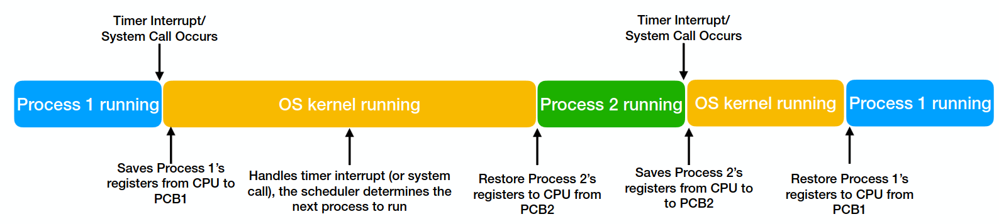
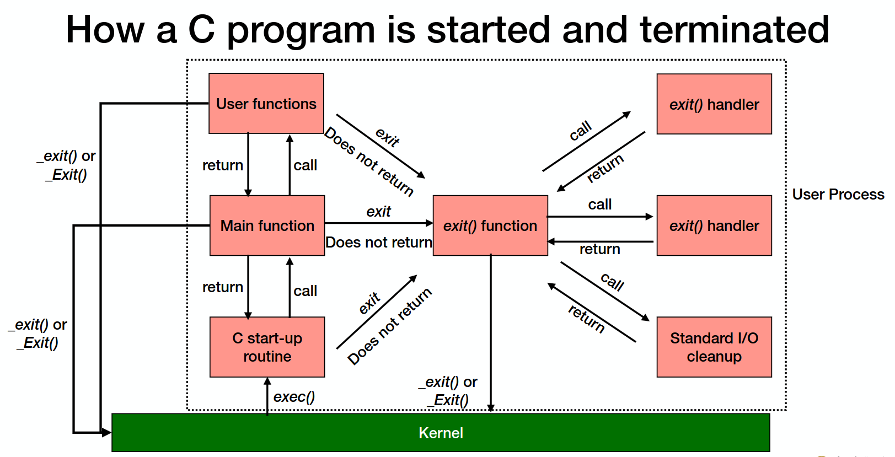
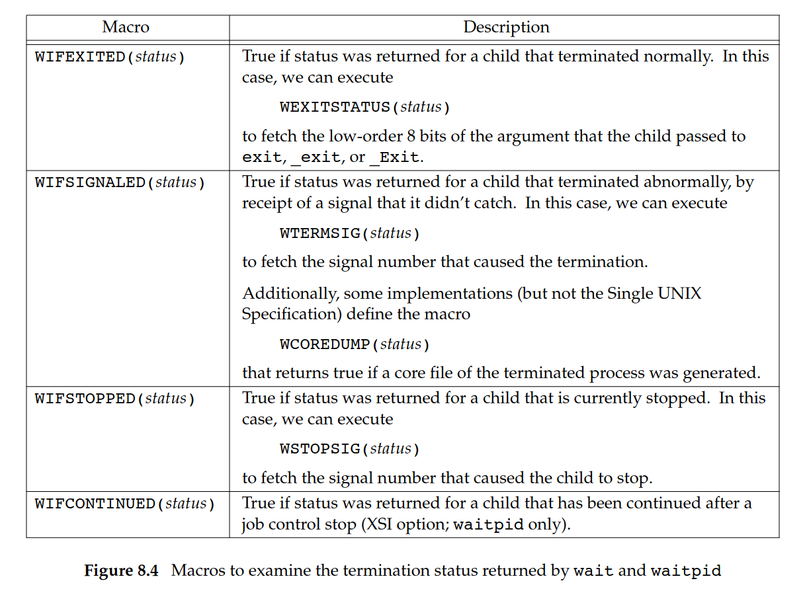
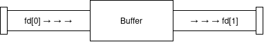
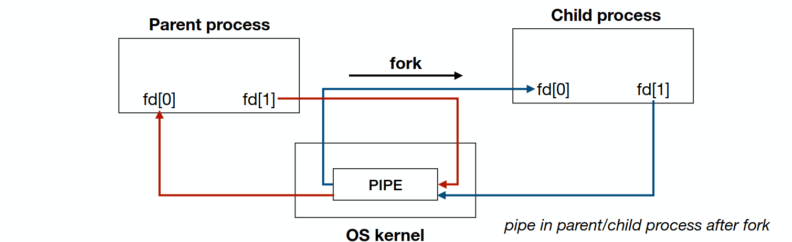
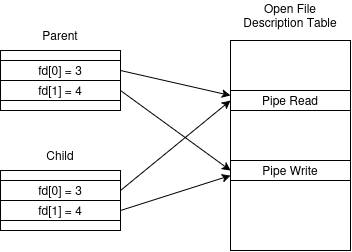

## What is Process?

Process 進程，是作業系統中用來管理工作的單位之一，可以把他想成一個國家中的個人，而 Kernel 就是國家的管理機構，實際上 Kernel 也是進程。與 Process 相比，Program 則是指存在硬碟上的執行檔，把 Program 載入記憶體並執行機器碼就叫 Process，所以 Process 是 Program 的實例（instance）。

系統為了管理 Process ，會給每個 Process 指派一個唯一的 ID（簡稱 PID），除此之外 Process 還會有自己的 Program Counter、State、Memory Layout、File Descriptor Table 等等，這些都存在一個叫做 Process Control Block （簡稱 PCB）的結構之中。 Linux 中定義的 PCB 叫做 `task_struct` ，細節可以到 [/include/linux/sched.h](https://github.com/torvalds/linux/blob/master/include/linux/sched.h#L835) 看，是一個長達數百行的結構。

```c
struct task_struct {
    ...
    pid_t                 pid;           /* Task ID (Kernel 內部的任務標識符) */
    pid_t                 tgid;          /* Thread Group ID (User Space 看到的 POSIX PID) */
    struct task_struct __rcu *real_parent;/* 建立此進程的原始父進程 */
    struct task_struct __rcu *parent;     /* 目前接收終止狀態與訊號的父進程 (Orphan 時指向 PID 1) */
    struct list_head      children;      /* 子進程鏈表頭 (指向自己創立的所有子進程) */
    struct list_head      sibling;       /* 兄弟節點 (將自己掛載於父進程的 children 鏈表中) */

    unsigned int          __state;       /* 進程狀態 (TASK_RUNNING, TASK_INTERRUPTIBLE, EXIT_ZOMBIE 等) */
    int                   prio;          /* 動態優先權 (排程器計算 CPU 資源分配與 Context Switch 的依據) */
    int                   static_prio;   /* 靜態優先權 (基於 nice 值計算) */
    unsigned int          policy;        /* 排程策略 (如 SCHED_NORMAL, SCHED_FIFO, SCHED_RR) */

    struct mm_struct     *mm;            /* 虛擬記憶體描述符 (包含 text, data, heap, stack 與 page table) */
    struct mm_struct     *active_mm;     /* 實際使用的虛擬記憶體空間 (Kernel Thread 借用其他進程的 mm) */

    struct files_struct  *files;         /* 檔案描述符表 (File Descriptor Table，包含 stdin/stdout/stderr 陣列) */
    struct fs_struct     *fs;            /* 檔案系統環境 (包含當前工作目錄 pwd 與根目錄 root) */

    const struct cred __rcu *cred;       /* 安全憑證 (包含 Real/Effective/Saved UID 及 GID) */

    struct signal_struct *signal;        /* 共享信號描述符 (同一個進程內所有 thread 共享) */
    sigset_t              blocked;       /* 被遮罩/阻塞的信號集合 (Signal Mask) */
    sigset_t              pending;       /* 已發送但尚未處理的懸掛信號集合 */
    ...
};
```

Unix 提供了 `getpid` 來獲得當前 PID、`getppid` 來獲得父進程的 PID：
```c
#include <unistd.h>
// Return: process ID of calling process
pid_t getpid(void);
// Return: the parent process ID of calling process
pid_t getppid(void);
```
## Process Lifecycle

前面提到 Process 會有執行狀態，分別是 New、Ready、Running、Waiting、Terminated：
- New：The process is being created
- Running：The program is executed on a CPU
- Waiting：The process is waiting for some events to occur
- Ready：The process is waiting to be assigned to a CPU
- Terminated：The process has finished execution

從 Running -> Ready 或 Ready -> Running，在 CPU 上執行、等待發配給 CPU 的過程就叫做 Context Switching。舉例來說， Process A 執行一段時間後， Kernel 會把他的狀態存到 Process 1 的 PCB，接著從 Process B 的 PCB 中取出 Process B 的狀態，接著執行一段時間後再換人。


來源：SP2026Fall sp07-proc-control.pdf

---
### `exec` & `fork`

假設我們正在撰寫一個 C 程式，希望它能夠執行 Linux 中的 `ls` 命令，列出目前目錄的檔案。最直覺的想法，可能是直接在程式中像在 shell 中呼叫 `ls` 一樣。事實上，Linux 確實提供了這樣的機制，也就是 `exec` 函式家族：

```c
#include <unistd.h>
// All return -1 on error; no return on success
int execl(const char *pathname, const char *arg0, … /* (char *)0 */ );
int execv(const char *pathname, char *const argv[]);
int execle(const char *pathname, const char *arg0, … /* (char *)0, char *const envp[] */ );
int execve(const char *pathname, char *const argv[], char *const envp[]);
int execlp(const char *filename, const char *arg0, … /* (char *)0 */ );
int execvp(const char *filename, char *const argv[]);
```

`exec` 函式家族的功能是以指定的 Program 取代目前進程，然後分配新的記憶體、暫存器等，但是進程本身的 PID 與父進程不會變，就像是把進程的外包裝留著，換掉內部的東西。
這些函式的功能大同小異，差別主要在於參數的傳遞方式，以及如何指定環境變數與搜尋執行檔。可以透過函式名稱中的字母來記憶：
- `l`：個別傳入參數
- `v`：以陣列傳入參數，注意最後一個參數後必須加上 `NULL`
- `p`：支援透過 PATH 搜尋執行檔（不用指定 `/bin/ls` 這類完整路徑）
- `e`：可以指定新程式的環境變數
比較常用的有 `execve` 與 `execvp`。

環境變數只是一堆字串，如 `{"A=1", "B=2", ...}` ，使用者需要自行解析並找出變數帶有的值。

舉例來說，讓程式執行 `ls`：
```c
int main() {
    printf("Before execvp\n");
    char *args[] = {"ls", "-l", NULL};
    execvp("ls", args);
    printf("After execvp\n");
    return 1;
}
```
輸出：
```
$ gcc myls.c && ./a.out
Before execvp
total 20
-rwxrwxr-x 1 admin admin 16048 Oct 24 22:27 a.out
-rw-rw-r-- 1 admin admin   154 Oct 24 22:27 myls.c
```

因為`execvp()` 成功時，會以新的 Program 取代目前進程，所以 `After execvp` 並不會被輸出。雖然說原進程大部分的屬性都會消失，但是有些屬性，如未設定 `FD_CLOEXEC` 標籤的 FD 還會繼續保留。如果沒使用帶有 `e` 的 `exec` ，那麼環境變數也會保留。注意如果執行的是帶有 `setuid/gid` 的 Program，那麼進程的 Effective UID/GID 也會改變。
此外，由 `fcntl` 設定的鎖也會保留，一個簡單判斷鎖會不會保留的方法就是看 PID 有沒有變。

`exec` 詳細的用法，以下程式都執行 `ls -l`：
```c
char *argv[] = {"ls", "-l", NULL};
char *envp[] = {"YEAR=2026", "COURSE=SystemProgramming", "SEMESTER=Fall", NULL};

execl("/bin/ls", "ls", "-l", NULL);
execlp("ls", "ls", "-l", NULL);
execl("/bin/ls", "ls", "-l", NULL, envp);
execv("/bin/ls", argv);
execvp("ls", argv);
execve("/bin/ls", argv, envp);
```

---

用 `exec` 並不能真的創造一個新進程，所以 `fork` 就來了，非遲但到。
當一個行程呼叫 `fork()` 時，系統會建立一個新的進程，稱為子進程（child process）；呼叫 `fork()` 的原始進程則稱為父進程（parent process）。在一般情況下，父進程與子進程會從 `fork()` 呼叫之後繼續執行。

```c
#include <unistd.h>  
// returns: 0 if in the child, process ID of child if in the parent, -1 on error 
pid_t fork(void);
```
呼叫 `fork` 後，系統會把父進程的狀態複製給子進程（乾一直打成紫禁城）。此時需要透過 `fork` 的回傳值分辨目前執行的身份是 parent 還是 child。如果 `fork` 回傳大於 0 的值表示在 parent，回傳 0 表示在 child。
`fork` 會失敗的原因通常是目前進程數量達到 Kernel 上限（4194304個），或每個使用者能擁有的進程數量達到上限（47812個）。

舉例來說：
```c
int main() {
    if (fork() == 0) { // fork 後 child 會從判斷回傳值開始
        printf("Hello from child\n");
    } else {
        printf("Hello from parent\n");
    }
    return 0;
}
```
輸出：
```
$ gcc fork.c && ./a.out
Hello from parent
Hello from child
```

子進程與父進程的不同之處在於， `fork` 後的那一刻他們都有相同的 Memory Layout、Program Counter、Call Stack、File Descriptor Table、Environment Variables、Effective UID/GID 等等，這種情況叫做子進程「繼承」父進程的狀態（Inheritance）。

當然還是有些東西不會繼承，如：Threads、POSIX File Locks（用 `fcntl` 設定的鎖）、Nonblocking IO Tasks 等。

除此之外，他們也不會共用記憶體空間，舉例來說：
```c
int main() {
    int x = 114514;
    if (fork() == 0) {
        x = 1919810;
        printf("child: x = %d\n", x);
    } else {
        printf("parent: x = %d\n", x);
    }
    return 0;
}
```
輸出：
```c
parent: x = 114514
child: x = 1919810
```

不論 child 如何更改 `x`， parent 所讀到的還會是原本的值。因此，變數 `x` 會被複製一份到 child 的記憶體中， Linux 為了節省系統開銷，採用了 Copy-On-Write 機制，只有當資料真的需要被修改時，才建立一份獨立的副本，它讓作業系統不必在建立 child process 時，立刻複製 parent process 的所有記憶體內容。

在 `fork` 完成後，此時 parent 和 child 的虛擬記憶體會對應到同一個記憶體分頁，此時這個分頁會被設為唯讀，讓兩者暫時無法直接修改這個共用頁面。假設 child 要寫入時，就會觸發頁面錯誤（Page Fault），說明出了某些問題。
在系統確認完這次是一個合法的寫入後，就會配置一個新的實體記憶體頁面，並將 child 的虛擬記憶體映射改成指向新頁面，然後將兩邊的頁面都設為可寫入。

`fork` 的常用場景：
- 父進程與子進程同時執行不同部份的程式，常用在 server
- 程式想要執行其他 Program 時，搭配與 `exec` 使用，如 shell

因為 CPU 會作排程，所以無法確定 parent 或 child 哪個先執行，所以最好的辦法，就是在父子進程間實作同步機制，給你做一個 Sleep 或 Pipe…。

`fork` 後是否繼承表：

| Item                                                       | Inherited?                    | Reason                                                               |
| ---------------------------------------------------------- | ----------------------------- | -------------------------------------------------------------------- |
| Global variables                                           | Yes                           | Part of the process's memory                                         |
| Local variables                                            | Yes                           | Part of the process's memory                                         |
| Heap memory                                                | Yes                           | Part of the process's memory                                         |
| Environment variables                                      | Yes                           | Represented in the process's memory                                  |
| File descriptors                                           | Yes                           | The child receives copies of the descriptor table entries            |
| Current working directory                                  | Yes                           | The child inherits the directory state                               |
| Signal mask                                                | Yes                           | Explicitly inherited                                                 |
| Pending signals                                            | No                            | The child's pending-signal set starts empty                          |
| PID                                                        | No                            | The child receives a new PID                                         |
| Parent PID                                                 | Different                     | The child's PPID identifies its parent                               |
| POSIX process-associated record locks (`fcntl`, `F_SETLK`) | No                            | Explicitly excluded from inheritance                                 |
| `flock()` locks on Linux                                   | Shared                        | Parent and child descriptors refer to the same open file description |
| Threads                                                    | No, except the calling thread | Only the thread that called `fork()` exists in the child             |

---

`vfork` 與 `fork` 相似，但有一個差異：
`fork` 讓父、子進程擁有各自的邏輯記憶體空間；`vfork` 則暫時讓子進程在父進程的位止空間中執行，並暫停父進程，直到子進程呼叫 `exec` 系列函式或 `_exit`。

`vfork` 的設計目的，是讓子進程可以快速呼叫 `exec` 執行另一個程式，免去了繼承父進程記憶體的開銷。不過，現在 `fork` 通常已實裝 COW 機制，因此 `vfork()` 的效能優勢不像早期那麼重要。

舉例：
```c
pid_t pid = vfork(); // 父進程卡在這
if (pid == 0) {
    execve(path, argv, envp);
    _exit(127);
}
// 等 _exit 後父進程繼續執行_
```

如果子進程沒有呼叫 `exec/_exit` ，或者修改父進程變數、呼叫函式，皆屬於未定義行為（Undefined Behavior），無法預期什麼會發生。

舉例：
```c
int x = 10;
pid_t pid = vfork();
if (pid == 0) {
    x = 20;
    _exit(0);
}
```

注意應該呼叫 `_exit` 來結束，不應該呼叫 `exit` 或 `return 0`，這些方式會清除 `atexit` 註冊的函式導致父進程結束的行為改變。
因為 `vfork` 預設使用者大概會呼叫 `exec` ，所以可以省去先複製父進程 Program 再切換到 `exec` 的 Program 的開銷。可以說 `vfork` 的限制比 `fork` 多，且現在 `fork` 也優化了，一般情況下不建議用。

---
### `exit`

```c
#include <stdlib.h> (specified in ISO C)
void exit(int status);
void _Exit(int status);
#include <unistd.h> (specified in POSIX.1)
void _exit(int status);
```
*正常*結束進程，也就是說會釋放資源。`status` 是結束狀態，常看到的 `return 0` 就是結束狀態 `0`，非零值代表不正常結束（執行錯誤等等），需要使用者自行解讀回傳值。

| 行為                  | `exit()` | `_Exit()`    | `_exit()`    |
| ------------------- | -------- | ------------ | ------------ |
| 定義標準                | ISO C    | ISO C（C99 起） | POSIX        |
| 執行 `atexit()` 註冊的函式 | 是        | 否            | 否            |
| 刷新 `stdio` 緩衝區      | 是        | 否            | 否            |
| 關閉 `stdio` streams  | 是        | 不執行標準 I/O 清理 | 不執行標準 I/O 清理 |
| 關閉進程的檔案描述符          | 是，經由終止程序 | 是，經由終止程序     | 是            |
| 終止進程                | 是        | 是            | 是            |


來源：SP2026Fall sp08-proc-control.pdf

```c
#include <stdlib.h>
// Returns 0 if OK, nonzero on error
int atexit(void (*func)(void));
```
註冊一個函式 `func`，然後該函式會在 `exit()` 執行時執行。父進程註冊的 `atexit` 函式 `fork` 後會被繼承。

舉例：
```c
static void exit_handler(void) {
    printf("All tasks done... Leaving...\n");
}
int main(void) {
	atexit(exit_handler);
	printf("Doing some tasks here...\n");
	return 0;
}
```
輸出：
```
$ gcc exit.c && ./a.out
Doing some tasks here...
All tasks done... Leaving...
```

---
### `wait`

```c
#include <sys/wait.h>
// Both return: process ID if OK, 0, or -1 on error
pid_t wait(int *statloc);
pid_t waitpid(int pid, int *statloc, int options);
```
- `wait` 用於等待**任一**子進程發生狀態改變，回傳改變後的狀態
- `waitpid` 用於等待**指定的**子進程發生狀態改變，回傳改變後的狀態，可傳入 `option` 參數
這裡的狀態改變是指以下任一發生：子進程終止（terminated）、子進程被信號暫停（stopped by signal）、暫停中的子進程被信號恢復（resumed by signal）。
`statloc` 傳入 `NULL` 可以忽略 child 的狀態回傳值。

其中 `waitpid` 會根據傳入的 `pid` 改變行為：
- `pid == -1`：等待所有子進程
- `pid > 0` ：等待指定的子進程 `pid`
- `pid == 0`：等待所有與 parent 擁有相同 `group id` 的子進程
- `pid < -1`：等待所有 `group id == |pid|` 的子進程
`option` 可以是以下多個值 bitwise OR：
- `WNOHANG`：Don't wait if there's nothing to report.
- `WUNTRACED`：Also report stopped children.
- `WCONTINUED`：Also report resumed children.

POSIX.1 也定義了一些 macro 來判斷 status：


舉例：
```c
int main() {
    pid_t pid = fork();
    if (pid < 0) {
        perror("fork");
    } else if (pid == 0) {
        printf("do some heavy work here... ");
        sleep(2);
        printf("heavy work done.\n");
        return 123;
    } else {
        int stat;
        if (wait(&stat) != pid) perror("wait");
        if (WIFEXITED(stat)) {
            printf("child returned %d.\n", WEXITSTATUS(stat));
        } else {
            printf("child terminated unexpectedly.\n");
        }
    }
    return 0;
}
```
輸出：
```
$ gcc wait.c && ./a.out
do some heavy work here... heavy work done.
child returned 123.
```

---
### Zombie Process & Orphan Process

child 執行完後，因為 `wait` 需要獲取 child 的終止資訊，所以系統會保留 `child` 的 PID 、狀態訊息等，並釋放 child 在執行時間的所有資源，之後 child 會留在系統的進程列表上，且不佔用任何 CPU 資源。在 `wait` 執行後，系統才會把 child 的資訊從進程列表上刪除。
也就是說，如果 parent 不執行 `wait` ，那麼 child 會一直留在進程列表上，佔用一個 PID 值，此時 child 稱為 **Zombie Process**。
因此，如果一個系統內的 Zombie Process 太多（那是挺多的），會導致程式無法創造新的進程。

可以用 `ps aux | grep 'Z'` 找出所有 Zombie Process：
```
$ ps aux | grep 'Z'
USER         PID %CPU %MEM    VSZ   RSS TTY      STAT START   TIME COMMAND
admin      18128  0.0  0.0   9316  2580 pts/0    S+   17:11   0:00 grep --color=auto Z
```

如果 child 還沒執行完，parent 就已經終止了，那麼 child 會失去它的 parent，此時 child 稱為 **Orphan Process**。接著系統會把 child 的 parent 設為 Init 這個 process， Init 會呼叫 `wait` 來正常回收 child，所以 child 不會變成 zombie process。
Init 是 Unix 系統啟動後，由核心建立的第一個進程，傳統上 PID 為 1， 它負責啟動並管理系統中的其他服務與進程。

如果 child 執行完了，parent 不呼叫 `wait`，且 parent 也結束了，此時 child 會變成 orphan process ，然後被 Init 回收，所以 child 不會變成 zombie process。

傳統上會利用 double fork 來建立 daemon，並避免 zombie process：
```c
pid_t pid = fork(); // parent -> child
if (pid < 0) perror("fork");
if (pid == 0) {
    pid_t daemon = fork(); // parent -> child -> grandchild
    if (daemon < 0) perror("daemon fork");
    if (daemon == 0) exit(0); // parent -> child(x) -> grandchild
    
    // daemon task here...
    exit(0);
}

if (waitpid(pid, NULL, 0) != pid) perror("waitpid");

// parent task continue...
exit(0);
```

此時 child 建立的 grandchild，也就是 daemon ，因為 child 結束了所以變成 orphan process，被 Init 接管後會自動呼叫 `wait` ，所以沒有 zombie process 的問題，而 parent 也可以繼續執行工作不需要被 `wait` 卡著。

現在 Linux 有 `systemd`（也就是 Init） 來管理 daemon 服務，所以不需要自己作 `fork`。

---
## Inter-Process Communication

Inter-Process Communication（簡稱 IPC），是用來專門給多個進程間互相溝通的通道，常用的 IPC 方式有：
- Pipes
- FIFOs
- Stream Pipes
- Message Queues
- Semaphores
- Shared Memory
- Sockets
- Streams

---
### Pipe & FIFO

```c
#include <unistd.h>
// Returns 0 if OK, -1 on error
int pipe(int fd[2]);
```
呼叫 `pipe` 後，會在 Kernal Space 開一個 buffer，並開啟兩個 FD：`fd[0]` 與 `fd[1]`。
`fd[0]` 是讀取 buffer， `fd[1]` 是寫入的 buffer 用的，兩者的檔案類型都是 FIFO。
注意， Pipe 只能用在有相同祖先的進程之間，也就是說，Pipe 只能從父進程繼承過來使用。

因為只能從 `fd[0]` 讀取、`fd[1]` 寫入，所以也被叫做半雙向（half duplex）通道，形象化的稱為 Pipe，類比圖：


在 `fork` 之後，因為 `fd[0]` 與 `fd[1]` 是 File Descriptor，所以會被複製。因此，在 child 中可以讀取 `fd[0]` 來存取 parent 在 `fd[1]` 寫入的訊息：

來源：SP2026Fall sp07-proc-control.pdf

因為 child 不會需要寫入訊息，所以可以把 `fd[1]` 關閉。而 parent 不需要讀取訊息，所以可以把 `fd[0]` 關閉。
因為此時 child 與 parent 複製 FD 後，兩者 `fd[0]` 與 `fd[1]` 雖然是相同數字，不過卻是兩個指標指向同一個 File Description，所以關閉其中一方的 FD 不會導致整個通道關閉：


舉例：
```c
char msg[] = "hello from parent";
int main() {
    int fd[2];
    if (pipe(fd) < 0) perror("pipe");

    pid_t pid = fork();
    if (pid < 0) perror("fork");

    if (pid > 0) {
	    close(fd[0]);
	    write(fd[1], msg, sizeof(msg));
	    wait(NULL);
    } else {
        close(fd[1]);
        char buf[128];
        int n = read(fd[0], buf, sizeof(buf));
        printf("child received: %s\n", buf);
    }
}
```
輸出：
```
$ gcc pipe.c && ./a.out
child received: hello from parent
```

一些 Remark：
- 如果目前 buffer 沒有東西可以讀取，那 `read(fd[0], ...)` 會卡著直到有人寫入 `fd[1]` 。相反地，如果 buffer 滿了（常數 `PIPE_BUF` 通常設為 4KB），`write(fd[1], ...)`  也會卡著直到有人讀取 `fd[0]`。因為 Pipe 也是檔案的一種，也可以設定 `O_NONBLOCK`，但哎喲你幹嘛...。
- 如果 parent 與 child 都關閉 `fd[1]`，那嘗試讀取 `fd[0]` 會讀到 EOF；如果 parent 與 child 都關閉 `fd[0]`，那嘗試寫入 `fd[1]` 會導致 `SIGPIPE` 發生，寫入的進程異常終止。
- 如果嘗試寫入超過 `PIPE_BUF` 大小的數據，那寫入的數據可能會跟其他寫入的數據混合；如果寫入的數據小於等於 `PIPE_BUF` ，那保證寫入的數據是一塊連在一起的（Atomic Operation）。

要避免數據混合，就要避免寫入超過 `PIPE_BUF` 大小的數據，或者將一串數據拆成兩個 Pipe 來傳輸，舉例：
```c
int command_pipe[2];
int data_pipe[2];
pipe(command_pipe);
pipe(data_pipe);

//ensure the data/cmd sent is < PIPE_BUF
void write_command(const char *cmd) {
    write(command_pipe[1], cmd, strlen(cmd));
}
void write_data(const void *data, size_t len) {
    write(data_pipe[1], data, len);
}
```

--- 

FIFO 其實就是有名稱的 Pipes（Named Pipes），與 Pipe 不同的是，FIFO 可以透過路徑存取：
```c
#include <sys/types.h>
#include <sys/stat.h>
// Returns 0 if OK, -1 on error
int mkfifo(const char *path, mode_t mode);
```
`path` 是 FIFO 的路徑，`mode` 是 FIFO 的檔案權限，`mode` 一定要包含 Read/Write。
FIFO 的好處是，他不只有相同祖先的進程可以使用，只要知道該 FIFO 路徑的進程都可以使用 `open/read/write` 來操作。
與 Pipe 一樣，FIFO 的 buffer 是存在 Kernel Space 的記憶體中，所以 FIFO 檔案實際上不儲存內容到硬碟。
FIFO 的其他行為與 Pipe 一樣，沒有寫入會卡著讀取端、可以用 `O_NONBLOCK`、寫入超過 `PIPE_BUF` 數據會混合…等等。

---
### Synchronization

因為 Pipe 有沒有寫入會卡著讀取端的特性，所以可以利用 Pipe 來同步兩個進程的執行順序：
```c
int main() {
    int fd[2];
    if (pipe(fd) < 0) perror("pipe");
    
    pid_t pid = fork();
    if (pid < 0) perror("fork");
    
    if (pid == 0) {
        close(fd[1]);
        
        printf("waiting for parent...\n");
        char buf[16];
        read(fd[0], buf, sizeof(buf));
        
        printf("child job here...\n");
        return 0;
    }
    
    close(fd[0]);
    
    printf("parent job here...\n");
    sleep(2);
    
    char sig[] = "ok";
    write(fd[1], sig, sizeof(sig));
    
    wait(NULL);
    printf("all job done.\n");
}
```
輸出：
```
$ gcc sync.c && ./a.out
parent job here...
waiting for parent... // wait for 2 seconds
child job here...
all job done.
```

如果兩者需要互相等待，那麼就可以開兩個 Pipe ，舉例來說讓 parent 與 child 同時退出：
```c
int pfd1[2], pfd2[2];
bool init_pipes() {
    return pipe(pfd1) == 0 && pipe(pfd2) == 0;
}
void wait_parent() {
	char buf[16];
    read(pfd1[0], buf, sizeof(buf));
}
void tell_parent() {
    char msg[] = "ok";
    write(pfd2[1], msg, sizeof(msg));
}
void wait_child() {
    char buf[16];
    read(pfd2[0], buf, sizeof(buf));
}
void tell_child() {
    char msg[] = "ok";
    write(pfd1[1], msg, sizeof(msg));
}

int main() {
    if (!init_pipes()) perror("pipe");
	pid_t pid = fork();
	if (pid < 0) perror("fork");
	
	if (pid == 0) {
	    printf("child job here...\n");
	    sleep(3);
	    printf("child done...\n");
	    tell_parent();
	    wait_parent();
	    return 0;
	}
	
	printf("parent job here...\n");
	sleep(3);
	printf("parent done...\n");
	tell_child();
	wait_child();
	printf("all done.\n");
	return 0;
}
```
輸出：
```
$ gcc wait2.c && ./a.out
parent job here...
child job here...
parent done...
child done...
all done.
```

所以可以用 Pipe 來解 Race Condition，但蠻蠢的。
同步處理有個重要的問題叫做 Deadlock（死鎖），是當雙方都必須等待對方完成才能執行時，無限互相等待的迴圈。
前面的 code 不會產生 deadlock 的原因是，雙方的工作是在等待對方之前就已經完成，而 Deadlock 是因為在**等待之後**才能完成。

以 `vfork` 來舉例：
```c
int var = 10;
int main() {
    pid_t pid = vfork();
    if (pid < 0) perror("vfork");
    if (pid == 0) {
        while (var < 20) sleep(1);
        _exit(0);
    }
    var += 100;
    return 0;
}
```

因為 `vfork` 會卡著父進程，而子進程又必須等待 `var >= 20` 才能繼續執行，所以屬於雙方互卡的操作，死機了。解決 Deadlock 的辦法就是定義好程式的行為，搞清楚誰該先等待，或者使用其他機制，從編寫時就避免掉。